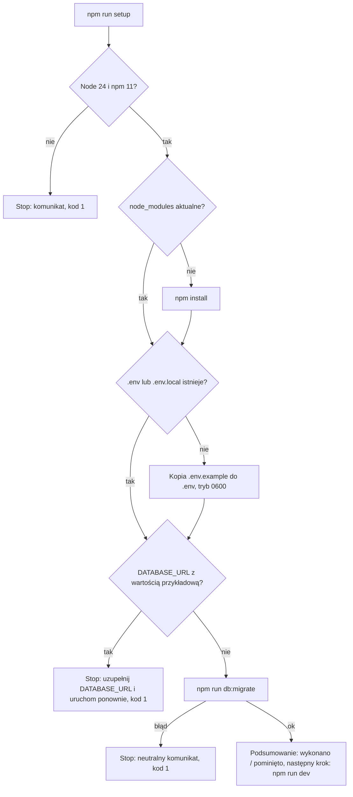

# Instalator Validuo: `npm run setup`

## 📝 TLDR

Osoba uruchamiająca Validuo lokalnie wykonuje dziś ręcznie kilka poleceń z sekcji „Uruchomienie” w `README.md` i musi pamiętać o wymaganiach (Node.js 24, npm 11, PostgreSQL 17). **Proponowane (przyszłe) zachowanie:** jedno polecenie `npm run setup` sprawdza wymagania, instaluje zależności, tworzy `.env`, stosuje migracje i podaje następny krok — i można je bezpiecznie uruchomić ponownie, bo pomija to, co już wykonano. Ręczne kroki zostają w README jako alternatywa. Źródło: [issue #11](https://github.com/RESSDESIGNSTUDIO/Validuo-OpenSource/issues/11).

## 📝 Problem Statement

Pierwsze uruchomienie wymaga pięciu poleceń w odpowiedniej kolejności (`npm install`, `cp .env.example .env`, uzupełnienie `DATABASE_URL`, `npm run db:migrate`, `npm run dev`) oraz znajomości wymagań. Kto pomyli kolejność lub pominie krok, dostaje błąd konfiguracji lub połączenia dopiero po kilku minutach. Brak w repo skryptu, który to automatyzuje (`package.json` w root nie ma skryptu `setup`; katalog `scripts/` nie istnieje).

## 📝 Proposed Solution

Pojedynczy skrypt Node.js uruchamiany z roota przez `npm run setup`, składający się z kroków sprawdzających stan („czy już zrobione?”) i wykonujących pracę tylko wtedy, gdy trzeba. Szczegółowe założenia:

- **Brak zależności przed instalacją.** Skrypt uruchamia `npm install`, więc **nie może** zależeć od niczego, co ta instalacja dostarcza (`tsx`, Zod, pakiety workspace). Dlatego jest zwykłym plikiem ESM `.mjs` używającym wyłącznie modułów wbudowanych Node (`node:fs`, `node:child_process`, `node:path`, `node:process`). To główny powód odrzucenia alternatywy „TypeScript przez `tsx`” (jak `packages/app/testing/ephemeral-app.ts`) — `tsx` nie istnieje na czystym klonie.
- **Odpowiedzialność jest rozdzielona:** logika decyzji („wykonaj/pomiń”, wykrywanie stanu, komunikaty) to czyste funkcje z wstrzykiwanymi zależnościami (system plików, uruchamianie procesów, wyjście), a cienki adapter spina je z prawdziwym Node. Dzięki temu całość da się pokryć testami jednostkowymi bez wykluczeń.
- Rozważone i odrzucone: osobny pakiet workspace (nowy pakiet wymaga zmian w architekturze i akceptacji człowieka); skrypt powłoki (`.sh`) — nie działa na Windows; własny parser `.env` w pełnej wersji — wystarczy minimalne wykrywanie `DATABASE_URL`, a właściwą walidację robi istniejący `parseServerEnv()` przy migracji.

## 📝 Architecture

Istniejące elementy: root `package.json` (`db:migrate`, `dev`), `.env.example`, `.nvmrc`, `engines`. Nowe: `scripts/setup.mjs` (punkt wejścia) i moduły logiki w `scripts/setup/`; wpis `"setup"` w `scripts` w root `package.json`. Skrypt nie importuje żadnego pakietu `@validuo/*` (granice pakietów i `no-restricted-imports` pozostają bez zmian). Skrypt **nie** czyta ani nie waliduje pełnej konfiguracji — robi to `parseServerEnv()` w kroku migracji, którego błąd wymienia tylko nazwy zmiennych.

## 📝 API Contracts (kontrakt CLI)

Polecenie: `npm run setup` (bez argumentów w pierwszej wersji; ewentualne flagi poza zakresem).

| Krok | Warunek pominięcia | Działanie |
| --- | --- | --- |
| Wymagania | — (zawsze sprawdzane, bez zmian w systemie) | Node major 24 (`engines`: `>=24 <25`), npm major ≥ 11; niezgodność = komunikat po polsku i wyjście przed jakąkolwiek zmianą |
| Zależności | `node_modules/.package-lock.json` istnieje i nie jest starszy niż `package-lock.json` | `npm install` (jak w README, nie `npm ci`, które usuwa `node_modules`); przy wątpliwości wykonaj krok |
| `.env` | istnieje `.env` **lub** `.env.local` w root (README dopuszcza oba) | Kopia `.env.example` do `.env` z prawami `0600`; **istniejącego pliku nigdy nie nadpisuje** |
| Kontrola `DATABASE_URL` | `DATABASE_URL` ustawiony w środowisku powłoki, `.env.local` lub `.env` i różny od wartości przykładowej (hasło `change-me`) | Gdy wartość przykładowa lub brak — stop z komunikatem „uzupełnij `DATABASE_URL` w `.env` i uruchom `npm run setup` ponownie”, kod 1, bez zmiany pliku |
| Migracje | brak oczekujących migracji, jeśli CLI pozwala to ustalić jednoznacznie bez parsowania tekstu | `npm run db:migrate` (`migration:up` jest idempotentne i pomija zastosowane); błąd = stop z neutralnym komunikatem i wskazówką, by sprawdzić dostępność bazy |
| Podsumowanie | — | Lista kroków z oznaczeniem „wykonano” / „pominięto”, następny krok `npm run dev` (http://localhost:3000, `/api/health`) |

- **Kody wyjścia:** `0` — wszystko gotowe (także przy ponownym uruchomieniu bez zmian); `1` — wymaganie niespełnione, konfiguracja do uzupełnienia lub błąd kroku.
- **Sekrety:** własne komunikaty skryptu nigdy nie zawierają wartości `DATABASE_URL` ani hasła (tylko nazwy zmiennych i ścieżki). Wyjście podprocesów (`npm`, CLI MikroORM) jest przekazywane wprost; błąd walidacji env w repo wymienia wyłącznie nazwy zmiennych.
- **Uruchamianie procesów:** bez powłoki (`shell: false`); `npm` wywoływany przez `process.execPath` + `npm_execpath` (ustawiany przez `npm run`), z awaryjnym `npm`/`npm.cmd`. Argumenty są stałe — żadna wartość z plików ani środowiska nie trafia do polecenia.

## 📝 UI/UX

Tylko wyjście terminala: jedna linia na krok w formacie `[wykonano]` / `[pominięto]` / `[błąd]` z krótkim opisem po polsku; przy błędzie — co poprawić i jak uruchomić ponownie. Bez kolorów wymuszanych na `NO_COLOR`/nie-TTY; bez interaktywnych pytań (skrypt działa także w CI i w skryptach powłoki).

## 📝 Edge Cases & Failure Scenarios

- **Pierwsze uruchomienie bez `.env`:** `.env` powstaje z przykładu, skrypt zatrzymuje się na kontroli `DATABASE_URL` (przykładowe hasło) z kodem 1; po uzupełnieniu kolejne uruchomienie przechodzi dalej i kończy się kodem 0 — to zamierzony, dwuetapowy przepływ.
- **Ponowne uruchomienie po sukcesie:** zależności, `.env` i migracje pominięte lub no-op, kod 0, `.env` bez zmian (test: ta sama zawartość i czas modyfikacji).
- **Baza niedostępna / złe dane:** krok migracji kończy się błędem; skrypt nie zmienia `.env`, zwraca 1.
- **`DATABASE_URL` tylko w środowisku powłoki:** uznany za ustawiony; `.env` nie jest tworzony, jeśli istnieje `.env.local`.
- **Zła wersja Node/npm:** wyjście przed `npm install`, bez zmian w repo. Wersja PostgreSQL nie jest weryfikowana (wymagałaby połączenia) — to poza zakresem.
- **Przerwanie (Ctrl+C) w trakcie `npm install`:** kolejne uruchomienie wykryje nieaktualny `node_modules/.package-lock.json` lub jego brak i powtórzy krok.
- **Windows:** brak założeń o powłoce i `chmod` (tryb `0600` jest best-effort, ignorowany tam, gdzie system go nie wspiera).
- **Uruchomienie spoza roota:** `npm run setup` zawsze działa z roota workspace; skrypt wyznacza root względem własnej lokalizacji, nie `process.cwd()`.

## 📝 Risks & Impact Review

- **Migracje na bazie z `DATABASE_URL`:** instalator robi to samo co README (`npm run db:migrate`, konto `MIGRATION_DATABASE_URL` lub `DATABASE_URL`). Nie używa i nie może używać `schema:update/fresh/drop` ani `migration:fresh` (AGENTS.md) — wymaga to testu pilnującego listy uruchamianych poleceń. Ryzyko jest średnie, bo użytkownik może wskazać współdzieloną bazę — skrypt przed migracją wypisuje nazwę hosta i bazy (bez hasła), nie pytając o potwierdzenie (brak interaktywności; decyzja do potwierdzenia przy implementacji).
- **Kontrakty (`BACKWARD_COMPATIBILITY.md`, „Skrypty i polecenia”):** zmiana jest addytywna (nowy skrypt). Wymaga aktualizacji `README.md` (sekcja „Uruchomienie” i tabela „Skrypty”) oraz tabeli poleceń w `AGENTS.md` (poza blokiem `nextjs-agent-rules`, który musi pozostać bez zmian co do bajtu).
- **Jakość kodu poza `packages/*/src`:** istniejąca konfiguracja pokrycia obejmuje tylko `packages/*/src`, a testy jednostkowe — `packages/*/{src,testing}`. Skrypt w `scripts/` wymaga rozszerzenia pól `include` (nie wykluczeń i nie progów) w `vitest.config.ts` o `scripts/**`, aby zachować 100% pokrycia. To zmiana konfiguracji bramki w kierunku zaostrzenia, ale dotyka pliku opisanego w AGENTS.md — patrz założenie Q4.
- **ESLint/Prettier:** `eslint` obejmuje cały repozytorium (w tym `.mjs`); `prettier --check .` też. Nie ma reguł granic dla `scripts/`; skrypt nie importuje pakietów, więc ryzyko jest niskie. `tsc` nie obejmuje `.mjs` — typowanie przez JSDoc jest opcjonalne i poza zakresem.
- **Cofnięcie:** usunięcie wpisu `setup` i katalogu `scripts/` przywraca stan sprzed zmiany; skrypt niczego nie zmienia poza `node_modules`, `.env` i stanem migracji, które użytkownik i tak tworzy ręcznie.
- **Weryfikacja ograniczona:** testy jednostkowe używają wstrzykiwanych portów; zachowanie na prawdziwym PostgreSQL (dwa przebiegi) trzeba sprawdzić ręcznie na tymczasowej bazie, nigdy na współdzielonej.

## Resolved assumptions (autonomous defaults)

Pytania z zgłoszenia #11 zostały rozstrzygnięte najmniej ryzykowną, najbardziej odwracalną odpowiedzią; człowiek może je zmienić przed implementacją.

| # | Pytanie | Wybrana odpowiedź | Uzasadnienie | Potwierdzenie |
| --- | --- | --- | --- | --- |
| Q1 | Czy instalator tworzy bazę/rolę PostgreSQL? | **Nie.** | Wymaga uprawnień administracyjnych; README zakłada istniejący PostgreSQL 17; zero nowej powierzchni. | — |
| Q2 | Czy na końcu uruchamia `npm run dev`? | **Nie**, tylko wypisuje polecenie. | Proces długotrwały; flaga `--dev` można dodać później bez zmiany kontraktu. | — |
| Q3 | Zachowanie przy `.env` z przykładowym hasłem? | **Stop** z komunikatem i kodem 1, bez migracji. | Nie migrujemy na domyślnych danych; najbezpieczniejsze i odwracalne. | — |
| Q4 | Gdzie mieszka skrypt i czy podlega progowi 100%? | `scripts/` w root, zwykły `.mjs` bez zależności; logika z wstrzykiwanymi portami; `vitest.config.ts` rozszerzony o `scripts/**` w polach `include` (testów i pokrycia), bez nowych wykluczeń i bez zmiany progów. | Skrypt musi działać przed `npm install` (brak `tsx`); 100% pokrycia bez `/* v8 ignore */`. | — |
| Q5 | Czy skrypt pyta o potwierdzenie przed migracją na wskazanej bazie? | **Nie** — brak interakcji; przed migracją wypisuje host i nazwę bazy (bez hasła). | Skrypt ma działać w CI i skryptach; to ten sam efekt co ręczne `npm run db:migrate` z README. | — |

## 📋 Phasing

- **Phase 1 — Instalator:** skrypt, testy jednostkowe, wpis `setup` w root `package.json`, rozszerzenie `vitest.config.ts`. Wartość: `npm run setup` działa i jest idempotentny.
- **Phase 2 — Dokumentacja:** `README.md` (opcja szybkiego startu, ręczne kroki jako alternatywa, wiersz w tabeli „Skrypty”) i tabela poleceń w `AGENTS.md`.

Każda faza jest niezależnie dostarczalna i zostawia aplikację działającą (dokumentacja bez skryptu byłaby nieprawdziwa, więc Phase 2 idzie po Phase 1, ale w jednym PR).

## 📋 Implementation Plan

### Phase 1 — Instalator

1. **Bramka testów.** Rozszerz pola `include` w `vitest.config.ts` (projekt `unit` oraz pokrycie) o `scripts/**` **przed** dodaniem kodu, aby 100% pokrycia nie przechodziło pozornie. Test: tymczasowy plik testowy w `scripts/` jest uruchamiany przez `npm run test:unit`, a nietestowany plik `.mjs` w `scripts/` obniża pokrycie poniżej 100%. Potwierdź też `npm run lint` i `npm run format:check`.
2. **Szkielet i wejście.** Utwórz `scripts/setup.mjs` (cienki punkt wejścia ustawiający `process.exitCode`) i `scripts/setup/run.mjs` z funkcją `runSetup(deps)` zwracającą kod wyjścia; dodaj `"setup": "node scripts/setup.mjs"` w root `package.json`. Test: `runSetup` z portami testowymi zwraca 0 dla scenariusza „wszystko gotowe”. Aplikacja działa bez zmian.
3. **Wymagania.** Funkcja czysta `checkRequirements({ nodeVersion, npmVersion })` + komunikaty po polsku; wywołanie przed jakąkolwiek zmianą. Testy: Node 23/25, npm 10, wersje poprawne, brak informacji o npm.
4. **Zależności.** `needsInstall({ lockMtime, hiddenLockMtime })` (brak ukrytego lockfile lub starszy = instaluj) i uruchomienie `npm install` przez port `runNpm`. Testy: pominięcie, brak `node_modules`, przerwana instalacja, błąd instalacji → kod 1.
5. **`.env`.** `ensureEnvFile` — tworzy `.env` z `.env.example` (tryb `0600`) tylko gdy nie istnieje ani `.env`, ani `.env.local`; nigdy nie nadpisuje. Testy: brak plików, istniejący `.env`, istniejący `.env.local`, brak `.env.example` (błąd z komunikatem), niezmieniona zawartość i mtime przy powtórce.
6. **Kontrola `DATABASE_URL`.** `findDatabaseUrl({ env, files })` według kolejności źródeł (środowisko powłoki, `.env.local`, `.env`) i `isPlaceholderDatabaseUrl` (porównanie z wartością z `.env.example`/hasłem `change-me`, bez logowania wartości). Testy: każde źródło, wartość przykładowa, brak zmiennej, cudzysłowy i komentarze w `.env`; test, że żaden komunikat nie zawiera hasła.
7. **Migracje.** Krok wywołujący `npm run db:migrate` przez port; wypisanie hosta i nazwy bazy bez hasła; mapowanie błędu na neutralny komunikat. Wariant bazowy (testowalny): zawsze uruchom `db:migrate` i oznacz krok jako „wykonano”. Opcjonalne usprawnienie, jeśli `migration:pending` daje jednoznaczny wynik bez parsowania tekstu (sprawdzone w implementacji, z osobnym testem): oznacz krok jako „pominięto”. Test: lista dozwolonych poleceń zawiera wyłącznie `npm install` i `npm run db:migrate` (zakaz `schema:*`, `migration:fresh`).
8. **Podsumowanie i adapter Node.** Formatowanie wyniku („wykonano/pominięto”, następny krok `npm run dev`) oraz adapter z prawdziwym `node:fs` i `node:child_process` (`shell: false`, `npm_execpath`). Testy adaptera na katalogu tymczasowym i prostym podprocesie; test punktu wejścia z podmienionymi modułami.
### Phase 2 — Dokumentacja

9. **README.** Test: `npm run format:check` i kontrola odwołań w treści. W sekcji „Uruchomienie” dodaj „Szybki start: `npm run setup`” (co robi, dwuetapowe pierwsze uruchomienie, idempotencja), zachowaj dotychczasowe kroki jako „Ręcznie (alternatywa)”; dodaj wiersz `npm run setup` do tabeli „Skrypty”.
10. **AGENTS.md.** Dodaj wiersz `npm run setup` do tabeli „Polecenia” (poza blokiem `nextjs-agent-rules`, który zostaje bez zmian).
11. **Weryfikacja ręczna.** Na tymczasowej bazie (`createdb`): czysty klon → pierwsze uruchomienie (stop na `change-me`) → uzupełnienie → drugie uruchomienie (sukces) → trzecie (same pominięcia, `.env` bez zmian); zapisz wynik w opisie PR. Nigdy na współdzielonej bazie.
